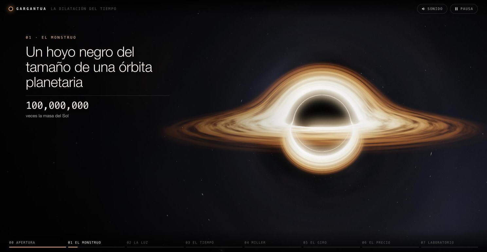
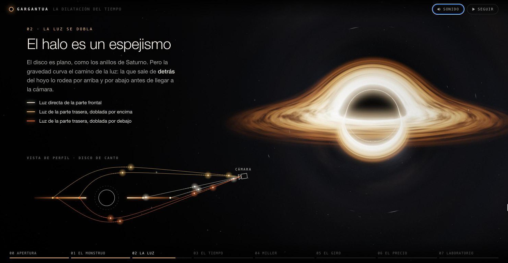
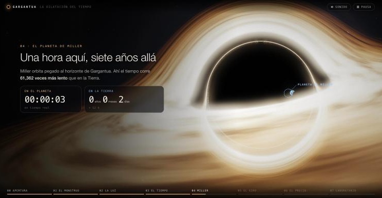
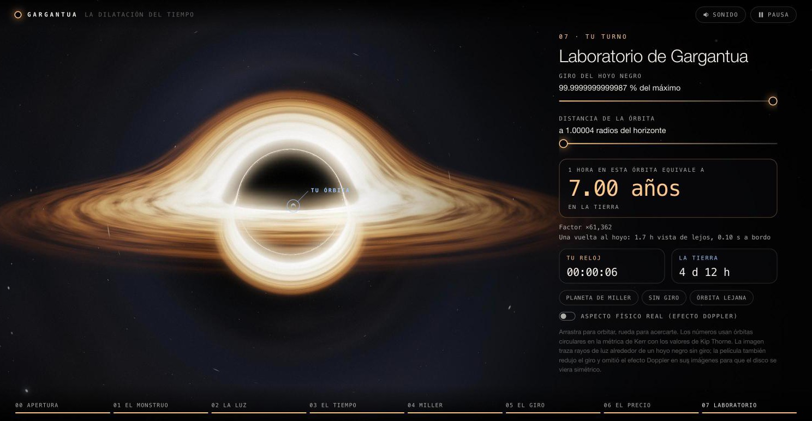

<div align="center">

# ◯ GARGANTUA

### La dilatación del tiempo, explicada con el hoyo negro de *Interstellar*

**Por qué una hora junto a este hoyo negro son siete años en la Tierra.**

[](https://israads.github.io/gargantua/)


<br>



</div>

<br>

## ✦ Qué es

Una experiencia interactiva de ocho capítulos que recorre la física real detrás de Gargantua, el hoyo negro de *Interstellar*. El hoyo negro no es un video: se calcula en tu navegador trazando rayos de luz que se curvan alrededor de él, cuadro por cuadro.

Avanza solo como una presentación, o puedes saltar entre capítulos, pausar y jugar con el laboratorio al final.

<br>

## ✦ Los capítulos

| | Capítulo | La idea |
|:-:|---|---|
| `00` | **Apertura** | Una hora aquí, siete años en la Tierra |
| `01` | **El monstruo** | Un hoyo negro del tamaño de una órbita planetaria: 100 millones de soles |
| `02` | **La luz** | El halo es un espejismo: la luz de atrás se dobla por encima y por debajo |
| `03` | **El tiempo** | Cuanto más hondo en el pozo, más lento el reloj |
| `04` | **Miller** | Una hora aquí, siete años allá, con dos relojes corriendo en vivo |
| `05` | **El giro** | Solo un hoyo negro que gira al límite lo permite |
| `06` | **El precio** | Dos relojes para una misma familia |
| `07` | **Laboratorio** | Tu turno: mueve el giro y la órbita y mira cuánto tiempo pierdes |

<br>

<table>
<tr>
<td width="50%"><br><sub><b>02 · La luz se dobla.</b> Diagrama de perfil de cómo la gravedad curva los rayos hacia la cámara.</sub></td>
<td width="50%"><br><sub><b>04 · Miller.</b> El reloj del planeta contra el de la Tierra, corriendo a la vez.</sub></td>
</tr>
</table>

<br>

## ✦ El laboratorio



- **Giro del hoyo negro** y **distancia de la órbita** con deslizadores.
- El resultado se calcula en vivo: cuánto tiempo pasa en la Tierra por cada hora en tu órbita, el factor de dilatación y cuánto tarda una vuelta.
- Atajos a **Planeta de Miller**, **Sin giro** y **Órbita lejana**.
- Interruptor de **aspecto físico real**: activa el efecto Doppler que la película omitió para que el disco se viera simétrico.
- Arrastra para orbitar, rueda del ratón para acercarte.

<br>

## ✦ La física

Los números usan órbitas circulares en la **métrica de Kerr** (hoyo negro en rotación) con los valores que Kip Thorne calculó para la película: unos 100 millones de masas solares y un giro casi máximo. Con eso, el planeta de Miller tiene un factor de dilatación de **≈ 61,000**, de ahí la famosa hora por siete años.

La imagen traza rayos alrededor de un hoyo negro sin giro, igual que la versión que se usó en pantalla: la película también redujo el giro y quitó el Doppler en sus imágenes.

<br>

## ✦ Controles

| Tecla | Acción |
|:-:|---|
| <kbd>←</kbd> <kbd>→</kbd> | Capítulo anterior o siguiente |
| <kbd>Espacio</kbd> | Pausa o sigue |
| <kbd>F</kbd> | Pantalla completa |
| <kbd>M</kbd> | Música |

El botón **Sonido** enciende la banda sonora con una entrada suave. Va apagado por defecto. Con el sonido activo, en el capítulo de Miller cada latido del reloj de la Tierra suena como un tic.

<br>

## ✦ Correrlo en local

No hay que instalar nada. Por la música conviene servirlo en lugar de abrir el archivo:

```bash
git clone https://github.com/israads/gargantua.git
cd gargantua
python3 -m http.server 8000
```

y abre <http://localhost:8000>.

<br>

## ✦ Archivos

```
gargantua/
├── index.html         la experiencia completa: estilos, shaders y lógica
├── interstellar.mp3   banda sonora
├── capturas/          imágenes de este README
└── README.md
```

<br>

## ✦ Créditos

- Música: *Interstellar*, de **QuentinGaming** (Pixabay).
- Valores físicos basados en *The Science of Interstellar* de Kip Thorne.
- Proyecto de divulgación sin fines comerciales, no afiliado a la película.

<div align="center">
<br>
<sub>◯ hecho para mirar el tiempo doblarse</sub>
</div>
